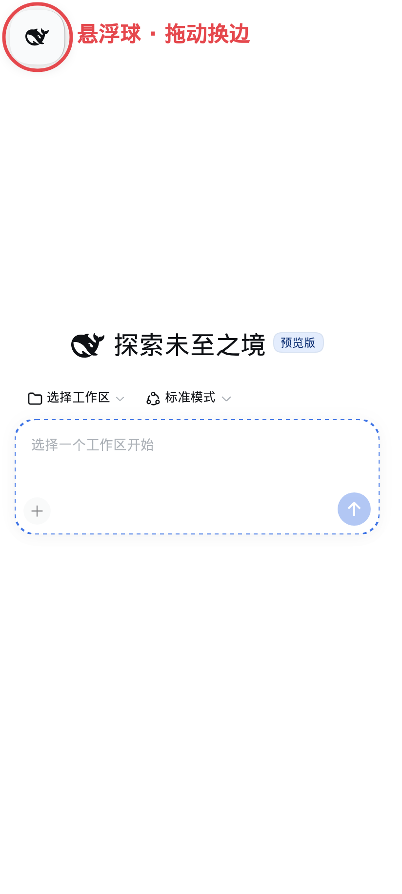
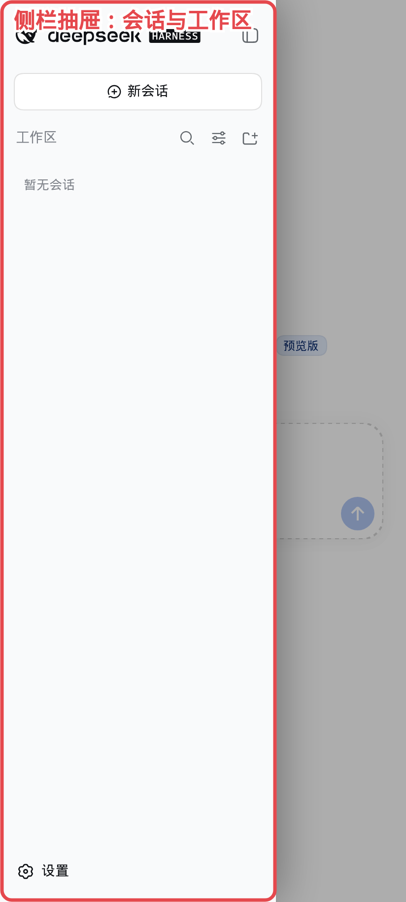

# dsh-mobile-upgrade

English | [简体中文](docs/zh-Hans/README.md) | [繁體中文](docs/zh-Hant/README.md) | [日本語](docs/ja/README.md) | [한국어](docs/ko/README.md) | [Español](docs/es/README.md) | [Français](docs/fr/README.md) | [Deutsch](docs/de/README.md) | [Русский](docs/ru/README.md)

Mobile quality-of-life fixes for the [DeepSeek Harness](https://github.com/deepseek-ai/deepseek-harness) (`dsh`) web profile, shipped as a single plugin. Almost everything renders through the host's own slots and state signals — no layout takeover, no DOM polling of chat content. A few overlays are fixed-position plain DOM on purpose — the bottom-left connection chip/card, the self-update banner, the shared toast: they must stay alive exactly while the host's own React tree is frozen.

## What you get

- **Restart row** — a "Restart service" entry in Settings → General. Confirms first, restarts the `dsh` process, and reloads the page automatically once the service answers again.
- **Narrow-screen drawer** — below 1024px the collapsed sidebar parks fully off-screen, replaced by the plugin's own floating button: a plain-DOM 56px round translucent element that is not the sidebar (the old chip was the sidebar itself, resized — broken by host rebuilds and skin restyles), with its own icon — the host's whale cloned and stripped of styling hooks — at a size pinned against any skin. Tapping it asks the host's own drawer controls (`[data-sidebar-opener]` / `[data-sidebar-toggle]`) to expand and slides the full-height sidebar in from the button's side as soon as the host lays the expanded rail out; the button fades out while the drawer stands, and a close tap (scrim, session row, header toggle) slides it back out in the same frame. The panel's width never changes, the transform-only slide cannot freeze halfway; the open drawer still paints an opaque surface from the theme's own sidebar tokens that a glass skin cannot turn transparent. The button stays draggable to either edge; the drawer opens from the side it is attached to, and a host control it did not press (the window-chrome opener, Escape, a remount) is mirrored instead of fought. Every host element this feature touches is found through a published `data-*` contract or a stable local class name — never a build hash.
- **Scrollable question card** — below 1024px a pending question can no longer bury its own choices: the question is capped into its own scroll region, so a long question scrolls in place while the option list below keeps whatever room is left and the options, the submit row and the minimize/close buttons stay on screen and reachable. A short question is untouched, and the card still hugs its content.
- **Storm-safe reactivity** — the drawer/menu observers and the settings poller react to a burst of streaming messages at a capped rate and back off while the host is unreachable, a rail remount during a reconnect keeps the drawer state instead of flapping it, and drawer close taps retry through a remount instead of landing on a stale toggle: many sessions streaming at once no longer freeze input or twitch the sidebar into unclickability, whether it is open or closed.
- **Subagent-catalog guard** — the host serves the subagent catalog by enumerating the whole session corpus per request (~1s on a long history), and its client asks on every selection, chip hover, and membership event. The plugin wraps that refresh: a parent with no children in the live session list is never asked, a parent is re-asked at most once per 2.5s, and refresh starts are spaced apart — a subagent fan-out no longer starves the host with full-corpus scans.
- **Click-to-open lineage chips** — on desktop the subagent chips ("N subagents" and the subagent title switcher) open on hover only in the current host; a click does nothing. The plugin translates a click on a chip into the hover event pair the host already understands, so clicking toggles the tree open/closed (ancestor crumbs keep their navigate-on-click).
- **Narrow-header collector** — below 1024px the session header's chips (lineage, jobs, preset) are wider than the phone and hover-only. They fold into one pill (`≡ title · N agents · M jobs`); tapping it opens a full-width sheet with the session lineage (each ancestor tappable, each with its descendant count), the subagent tree rooted at the family root — rows render from the live session list, branches fetch their catalog on demand through the guarded refresh — and this session's background jobs. On desktop nothing changes.
- **Session-list render throttle** — the host pushes a whole-value projection frame for every projection change of every attached session, and a running subagent's timing view changes on every committed event, so a busy background fleet streams 50-150 frames/s into the page. Each frame used to re-render the whole session list (one rebuild walks every summary plus an O(n²) cache sweep — measured as most of the main-thread time, freezing the page until reload). The plugin coalesces those re-renders onto an adaptive trailing interval while the values keep flowing into the per-session stores unchanged, so background streaming no longer freezes the page — on any session, new or old.
- **Connection card** — the host's bottom-left connection control reacts to a click with nothing observable: the retry it requests dives back into the same wedged transport, the recovery pill is an unclickable div on a timer, and the narrow rail/drawer sidebar never renders it at all. This plugin anchors the status with a plain-DOM chip at the bottom-left corner (alive even while the host's React tree is frozen) and pops a semi-persistent card above it: the card stays while the pointer is inside it, auto-dismisses otherwise, and carries the two actions that actually work — an immediate reconnect through the connection service and a full manual page refresh. Stuck or failed `/api/` requests surface in the same place: a badge and count on the chip, a request list plus a liveness probe inside the card — nothing warns beside the composer's controls any more, no matter how many requests hang or fail.
- **Self-update** — the client bundle is served immutable per revision, so a phone tab can keep running an older build for days. The page compares the revision it booted with against the one the server publishes now and reloads itself once the page has been idle (never while a draft is being typed), or offers a tappable banner.
- **Per-feature toggles** — the plugin installs a `dsh-mobile-upgrade` section in Settings → Plugins with a switch per feature.

## Screenshots

The floating button, the session drawer, the narrow-screen settings tabs and the narrow-header collector (annotated):

| | |
|---|---|
|  |  |
|  |  |

## Install

```sh
dsh plugin --profile web add dsh-mobile-upgrade
```

Restart `dsh web`, then open the web profile on your phone: the restart row sits in Settings → General and the feature toggles in Settings → Plugins → dsh-mobile-upgrade. Attachments come from the host's own composer attachment system.

Requires `dsh` 0.2.0-rc.2 or newer; developed and verified against `dsh` 0.2.2 (the host's built-in attachment system replaced this plugin's upload feature). 0.2.2 already ships a narrow-screen drawer, settings tabs, a bounded model menu and a per-model input-type editor; this plugin no longer duplicates them, so those overrides were removed rather than re-hashed, and what remains is the floating-button takeover plus the enhancements below.

## Configuration

The plugin's settings card lists one switch per feature (see [Feature toggles](#feature-toggles)); `restartEnabled` also gates the restart route:

| Key | Default | Meaning |
|---|---|---|
| `restartEnabled` | `true` | Offer the restart row and its route |

## Feature toggles

Every feature above can be switched in Settings → Plugins → dsh-mobile-upgrade (effective on the next page load), or overridden per device with a `localStorage` key — `mfx-restart`, `mfx-drawer`, `mfx-net`, `mfx-questions`, `mfx-selfupdate`, `mfx-agents`, `mfx-header`, `mfx-listthrottle`, `mfx-conn` — where the value `"0"` turns a feature off.

## Limitations

- The client binds host UI elements through published `data-*` contracts (`data-sidebar-drawer`, `data-sidebar-collapsed`, `data-sidebar-mask`, `data-sidebar-toggle`, `data-sidebar-opener`, `data-rightbar-col`, `data-shortcut-modal`, `data-slot`) and, where the host publishes no attribute, through the local part of a CSS-module class name (`_sidebarCol`, `_crumbs`, `_tabs`). Both survive a rebuild: the hash in front of a local name is the only thing a rebuild changes. A host build that renames those contracts degrades the affected feature until this plugin catches up; everything else keeps working. The question card's question region rides the card's own `data-question-key` hook.
- The header collector and the lineage click shim ride the host's own data (the live session list and its subagent catalogs); they add no requests beyond the guarded branch fetches, and a tap on a row whose mode is still loading completes on its own once that catalog lands.
- Input-modality switches can only patch provider routes you have customised yourself; catalog-only routes are read-only by design, because fabricating a catalog section collapses the model directory.

## Security notes

The plugin's HTTP routes (restart, settings editing) run on the same web server as the host's own, so they are fenced through the connection service's `requestRejection`: the same Host/authority check and browser-session check the host's gateway applies (403 for an untrusted authority, 401 without a valid browser session). A route that restarts the process or rewrites the profile's provider directory is therefore not reachable from the network unauthenticated. On a host that does not expose that face, the routes fall back to the deployment's own gate and the host half logs a warning — put the deployment behind whatever gate protects the rest of the UI (reverse-proxy auth, loopback binding) before exposing it beyond localhost.

## Community Links

- [Linux.Do](https://linux.do) — A community for sharing and discussing technology.

## License

Distributed under the [Synthetic Source License (SySL), Version 1.0](LICENSE).

> NOTICE: This software includes code generated by artificial intelligence. See the LICENSE file for the Synthetic Source License terms, including model disclosure requirements.
