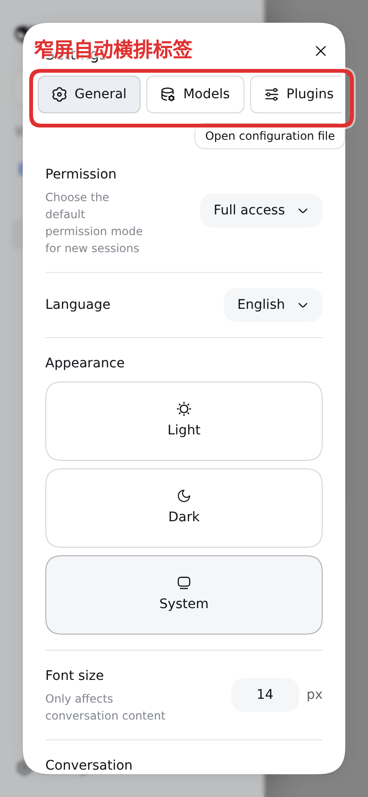
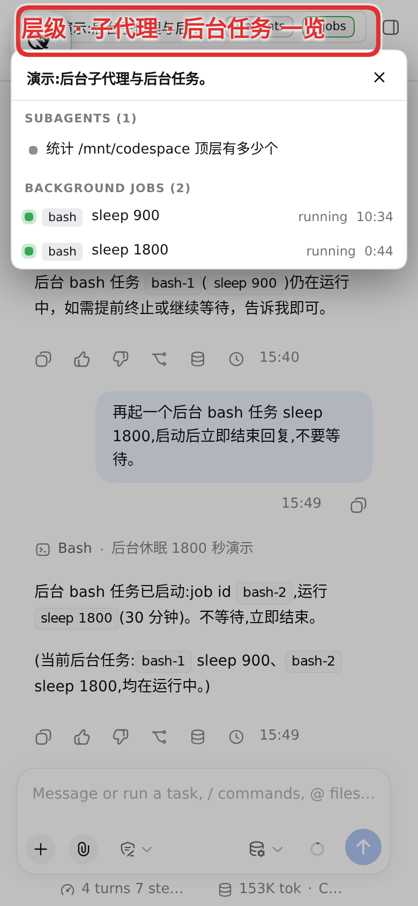

# dsh-mobile-upgrade

[English](../../README.md) | 简体中文 | [繁體中文](../zh-Hant/README.md) | [日本語](../ja/README.md) | [한국어](../ko/README.md) | [Español](../es/README.md) | [Français](../fr/README.md) | [Deutsch](../de/README.md) | [Русский](../ru/README.md)

面向 [DeepSeek Harness](https://github.com/deepseek-ai/deepseek-harness)（`dsh`）web profile 的手机端体验修复，以单个插件交付。界面几乎都走宿主自身的槽位与状态信号——不接管布局、不轮询聊天内容。少数覆盖层刻意用固定定位的纯 DOM——左下角连接芯片/卡片、自更新横幅、共享提示条：它们必须恰好在宿主 React 树冻结时依然存活。

## 你会得到

- **重启服务行** — 设置 → 通用里多一条「重启服务」。先确认，再重启 `dsh` 进程，服务恢复应答后页面自动刷新。
- **可滚动的问题卡片** — 1024px 以下待回答的问题再也无法埋没自己的选项：问题被限制在自有的滚动区域内，于是长问题就地滚动，下方的选项列表保有剩余空间，选项、提交行与收起/关闭按钮始终留在屏幕上并可以点到。短问题不受影响，卡片仍贴合自身内容。
- **风暴安全的响应性** — 问题卡片的全文档观察器与设置轮询器以受限速率响应流式消息爆发，宿主不可达时自动退避：大量会话同时流式输出不再冻结输入或让页面卡顿，侧栏本身交给宿主自己的窄屏布局处理。
- **子代理目录防护** — 宿主每次请求都遍历整个会话语料来生成子代理目录（长历史下约 1s），其客户端又在每次选择、芯片悬停与成员变动事件时发起询问。插件包住这次刷新：活跃会话列表中没有子代理的父级不再被询问，同一父级至多每 2.5s 被问一次，刷新起点彼此错开——子代理扇出不再用全量语料扫描拖垮宿主。
- **点击展开的谱系芯片** — 桌面端上，子代理芯片（「N 个子代理」与子代理标题切换器）在当前宿主里只对悬停展开，点击无效。插件把芯片上的点击翻译成宿主已经理解的悬停事件对，于是点击即可开合子代理树（祖先面包屑保留原有的点击跳转）。
- **窄屏头部收纳器** — 1024px 以下，会话头部的芯片（谱系、任务、预设）比手机还宽且只能悬停。它们折叠成一枚胶囊（`≡ 标题 · N agents · M jobs`）；点按后打开全宽面板，内含会话谱系（每个祖先都可点按，并标注各自的后代数）、以家族根为根的子代理树——行数据渲染自活跃会话列表，分支经防护刷新按需拉取目录——以及本会话的后台任务。桌面端保持不变。
- **自更新** — 客户端 bundle 按修订版不可变分发，手机标签页可能连跑旧构建好几天。页面把启动时的修订版与服务器当前发布的修订版比对，待页面空闲时（绝不在输入草稿期间）自行重载，或给出可点按的横幅。
- **会话列表渲染节流** — 宿主对每个已挂载会话的每次投影变化都推送一个全值帧，而运行中子代理的计时视图在每个已提交事件上都会变化，于是繁忙的后台机群会以每秒 50-150 帧灌进页面。每个帧此前都会重渲染整个会话列表（一次重建要遍历全部摘要外加 O(n²) 缓存清扫——实测占掉主线程的大半时间，页面冻结到只能重新加载）。插件把这些重渲染合并到一个自适应的尾随间隔上，同时数值仍原封不动地流入各会话自己的存储——后台流式输出不再冻结页面，无论是新会话还是旧会话。
- **连接状态卡片** — 宿主左下角的连接控件点击后毫无可感知的反应：它请求的重连扎回同一条已经僵死的传输，恢复提示是个不可点击、靠定时器消失的 div，而窄屏的侧栏抽屉干脆不渲染它。插件在左下角用纯 DOM 芯片锚定连接状态（宿主 React 树冻结时依然存活），并在其上方弹出半常驻卡片：指针在卡片内时它不消失，移开后自动消失；卡片里是两个真正有效的操作——通过连接服务立即重连，以及整页手动刷新。卡住或失败的 `/api/` 请求也在同一处呈现：芯片上有徽标与计数，卡片里是请求清单加服务探活——无论多少请求挂起或失败，聊天输入框旁边不再出现任何警告。
- **逐功能开关** — 插件在 设置 → 插件 里安装 `dsh-mobile-upgrade` 设置节，每个功能一枚开关。

## 截图

窄屏设置标签与窄屏头部收纳器（含标注）：

| | |
|---|---|
|  |  |

## 安装

```sh
dsh plugin --profile web add dsh-mobile-upgrade
```

重启 `dsh web`，然后在手机上打开 web profile：重启行在 设置 → 通用，功能开关在 设置 → 插件 → dsh-mobile-upgrade。附件请直接使用宿主输入框自带的附件系统。

需要 `dsh` 0.2.0-rc.2 或更新版本；本插件针对 `dsh` 0.2.2 开发与验证（宿主内置附件系统已取代本插件的上传功能）。宿主现在自带窄屏侧栏的完整体验——抽屉及窗口栏两个顶角处的打开按钮、设置标签、受宽度约束的模型菜单以及按模型编辑输入类型的编辑器——因此本插件不再触碰侧栏：自己的抽屉接管与悬浮球已随之退役，而不是继续与原生实现互相缠斗，留下的是下列增强。

## 配置

插件设置卡按功能列出开关（详见「功能开关」一节）；`restartEnabled` 还控制重启路由：

| 键 | 默认值 | 含义 |
|---|---|---|
| `restartEnabled` | `true` | 提供重启服务行及其路由 |

## 功能开关

上文每个功能都可以在 设置 → 插件 → dsh-mobile-upgrade 里切换（下次页面加载生效），也可以按设备用 `localStorage` 键覆盖——`mfx-restart`、`mfx-net`、`mfx-questions`、`mfx-selfupdate`、`mfx-agents`、`mfx-header`、`mfx-listthrottle`、`mfx-conn`——值为 `"0"` 即关闭该功能。已退役抽屉的 `mfx-drawer` 键及其按设备记录的拖拽位置（`mfx-chip-side` / `mfx-chip-top`）不再被读取，清掉与否均可。

## 已知限制

- 客户端通过宿主公开的 `data-*` 契约——问题卡片的 `data-question-key` 与头部收纳器的 `data-slot` 座位——挂钩宿主 UI；宿主没有发布属性时，改用 CSS 模块类名的 local 部分（`_crumbs`、`_tabs`、`_headingBlock`）。已退役抽屉用过的侧栏钩子（`data-sidebar-*`、`data-rightbar-col`、`data-shortcut-modal`、`_sidebarCol`）已随之删除。这些钩子都能跨构建存活：构建只改变 local 名前面的哈希。宿主若重命名仍存的契约，对应功能会降级，待本插件跟进适配；其余功能不受影响。
- 头部收纳器与谱系点击垫片都跑在宿主自身的数据上（活跃会话列表及其子代理目录）；除受防护的分支拉取外不新增请求，点按某个模式仍在加载中的行，会在对应目录到达后自行完成。
- 输入模态开关只能补写你自行定制过的供应商路由；纯目录路由按设计只读——凭空造一个目录节会导致模型目录塌掉。

## 安全说明

插件的 HTTP 路由（重启、设置编辑）与宿主共用同一个 web server，因此统一走 connection 服务的 `requestRejection`：与宿主网关相同的 Host/来源校验与浏览器会话校验（来源不可信返回 403，没有有效浏览器会话返回 401）。这样一条会重启进程、改写 profile 供应商目录的路由，就不再能从未认证的网络侧访问。若宿主没有暴露该接口，路由回退到部署自身的闸门，宿主半边会记一条警告——对外暴露部署之前，请仍把它放到保护其余界面的同一道闸门之后（反代认证、仅回环绑定）。

## 社区链接

- [Linux.Do](https://linux.do) —— 一个分享和讨论技术的社区。

## 许可

以[合成源代码许可证（SySL）1.0 版](LICENSE)分发。

> NOTICE: This software includes code generated by artificial intelligence. See the LICENSE file for the Synthetic Source License terms, including model disclosure requirements.
